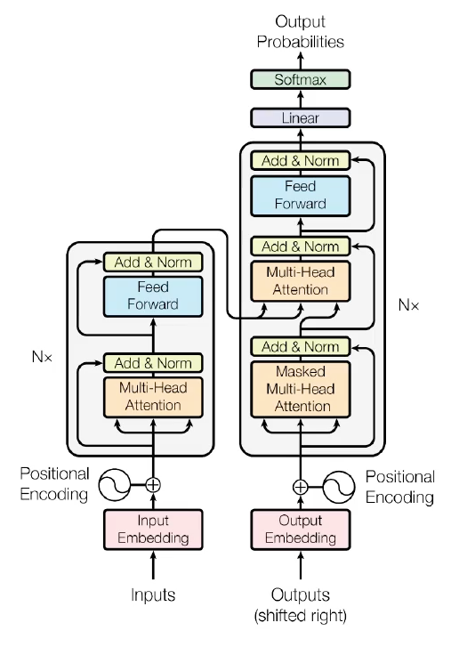
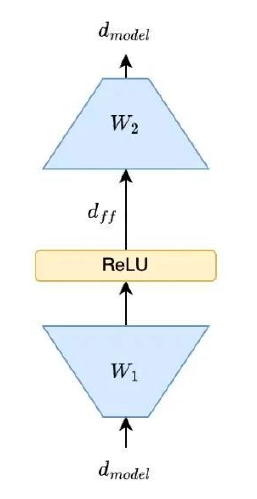

# Transformer Model

From-scratch PyTorch implementation of the Transformer (Vaswani et al., 2017), built module by module, then wired into a full encoder–decoder. A separate transfer-learning file fine-tunes `bert-base-chinese` for binary text classification.

---

## Architecture

The model follows the standard encoder–decoder stack: token + positional embeddings, multi-head attention, position-wise feed-forward networks, residual connections with LayerNorm, and a final linear + softmax generator.

<p align="center">
  
</p>

<p align="center"><em>Figure 1. Transformer encoder–decoder (N stacked layers each side).</em></p>

Each encoder / decoder layer contains a **position-wise feed-forward** block: expand \(d_{model} \rightarrow d_{ff}\) with \(W_1\), apply ReLU, then project back with \(W_2\).

<p align="center">
  
</p>

<p align="center"><em>Figure 2. Feed-forward sub-layer: \(d_{model} \xrightarrow{W_1} d_{ff} \xrightarrow{\mathrm{ReLU}} d_{ff} \xrightarrow{W_2} d_{model}\).</em></p>

File hyperparameters (see local `config.py`) are small for fast shape checks; paper defaults are noted in comments (`d_model=512`, `d_ff=2048`, `N=6`, `h=8`).


## Setup

```bash
pip install torch transformers datasets tqdm
```

Apple Silicon uses MPS when available; CUDA is preferred when present. Classification caches write under `.hf_cache/`.


## Transfer learning: text classification

`Transfer_Chinese_Classification.py` loads pretrained **BERT**, freezes the backbone (optional), and trains a linear head on `data/*.csv`.

```bash
python Transfer_Chinese_Classification.py
```

Pipeline: load CSV splits → one-batch shape check → `train_model(freeze_bert=True)`. Training helpers (`BertClassifier`, dataloaders, `train_model`) are defined in `config.py`.

---

## Reference

Vaswani et al., *Attention Is All You Need*, NeurIPS 2017.
